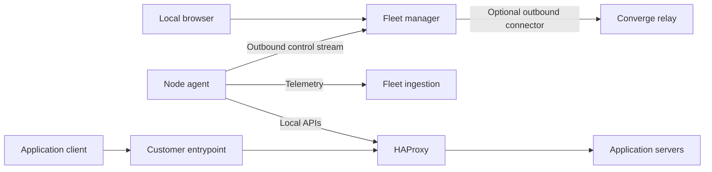

# Architecture

Fleet manages HAProxy® load balancers on infrastructure owned by the operator.
The manager, node agents and optional Converge connector form the management
plane. Application traffic uses the customer's entrypoint, proxies and servers.

There is one agent per HAProxy node. A cluster groups nodes for observation and
coordinated operations. Enrollment does not install HAProxy, create a shared VIP
or distribute traffic between nodes. The operator supplies the entrypoint, such
as a provider load balancer, a floating IP or a managed HAProxy entrypoint.

## Components and storage

| Component       | Responsibility                                                                          |
| --------------- | --------------------------------------------------------------------------------------- |
| Manager         | Embedded console, local login, enrollment, configuration versions, operations and audit |
| Ingestion       | Node authentication, bounded report validation and telemetry writes                     |
| Agent           | Local discovery, metrics and explicitly permitted runtime/configuration operations      |
| PostgreSQL      | Identities, local accounts, desired state, jobs, audit and latest metric summaries      |
| VictoriaMetrics | Historical numerical observations                                                       |
| VictoriaLogs    | Opt-in request observations                                                             |

Manager and ingestion use the same Go codebase with separate roles and resource
budgets. They have their own storage; telemetry does not pass through Converge's
Phoenix backend or database. The latest two validated summaries per node serve
live metrics while historical queries use VictoriaMetrics.

## Connections and authority

Agents initiate mutually authenticated control and telemetry connections.
Commands return over the existing control stream. Local Runtime API and Data
Plane API access stays inside the customer's network. The agent has no remote
shell or Docker/systemd upgrade authority.

Monitoring is the starting point. Management requires both an authorized
operator and an independently configured local agent policy. Runtime changes use
the Runtime API; persistent configuration uses the Data Plane API. An existing
configuration owner must explicitly delegate that authority before Fleet writes.

Configuration rollouts retain a verified rollback base. With a managed entrypoint,
each node is withdrawn and drained before an update, checked and rejoined before
the next node proceeds. Failed verification triggers recovery, whose result stays
visible. HAProxy changes use permissions and audit history without a review flow.
Converge DNS changes retain their separate review process.

## Independent and connected use

The embedded console and local accounts work without Converge. Linking a manager
creates an outbound, scoped connection to a relay. Converge provides its own
login and permissions through that link; it does not receive node private keys
or become part of the traffic path. Unlinking leaves local access available.

A manager outage stops management and observation. HAProxy processes continue
serving their installed configurations. Entrypoint availability, application
health and certificate validity still depend on the customer's deployment.

## Updates and recovery

Host-owned tools verify an exact release, publisher and artifact digest before
activation. Software updates and rollback preserve identity directories, local
policies, certificates and keys. Missing identities fail closed.

Encrypted backups include manager state and the complete private node state.
Cold restores remain stopped until the source is fenced and activation is
explicit. Restoring software never substitutes for verifying application traffic.

The public Fleet publisher is distinct from the private predecessor. Existing
installations retain their original verification path until a cross-publisher
upgrade and rollback have been qualified. See the
[repository transition](migration-to-fleet.md), [recovery guide](self-hosted-installation.md)
and [security boundaries](../SECURITY.md).

---

HAProxy® is a registered trademark of HAProxy Technologies SAS. Ecraela Fleet
is not affiliated with or endorsed by HAProxy Technologies.
