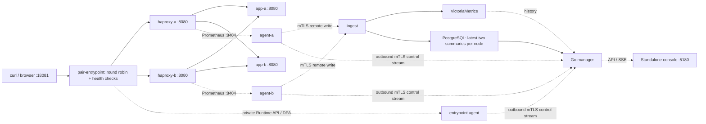

# Development and local demos

Run commands from the Ecraela Fleet repository root unless a section says otherwise.
The two-node lab defaults to standalone mode. Set `HAPROXY_PAIR_STANDALONE=0`
only when intentionally enabling the Converge development overlay.

## Traffic and management topology

For repeatable load, failure and full node-key recovery tests, see the
[hardening runbook](haproxy-hardening.md). Run `make hardening`
from the repository root after preparing the two-app HTTP/HTTPS demo. This
creates an isolated restore copy, keeps the source serving, and deletes its
private checkpoint afterward. It does not certify production capacity.

The original single-node local stack contains one actual HAProxy process (`haproxy`) and one demo
application (`demo-backend`). `http://localhost:18080` publishes that HAProxy's
8080 listener, which forwards to the application. The manager and ingestion
services are outside this traffic path. Traffic continues with its applied
configuration if the management stack is unavailable.

The guided command starts an **agent**, which observes an existing HAProxy
instance at the configured metrics address. Running two agents against
`http://haproxy:8404/metrics` creates two identities observing the same proxy.
It does not create a second proxy, add backend application servers, or configure
traffic distribution. Enrollment groups identities; routing is separate. Declared topology can associate those identities with their actual traffic listeners.

To add a real proxy node, first deploy another HAProxy instance, configure its
application backends, then enroll an agent with that instance's own metrics
listener. Two active proxies need an upstream load balancer or routing layer to
distribute incoming traffic. An active/standby pair needs a supported failover
mechanism such as Keepalived/VRRP or a provider floating IP. Neither topology is
implemented automatically by enrollment. HAProxy's `balance roundrobin` setting
selects application servers within its configured backend pool.

Agents enroll with the manager over HTTPS and send authenticated metrics to
ingestion using mTLS. Ingestion writes history to VictoriaMetrics and keeps the
latest two validated summaries per node in the manager's own PostgreSQL. The
manager uses these summaries for live SSE and queries VictoriaMetrics for
history. PostgreSQL also stores identities, inventory and audit. The local
console uses its own login. Optional Converge integration does not store HAProxy
samples in Converge's application database.

The hosted profile can run this stack in Ecraela infrastructure, with agents in
customer networks. A self-hosted installation runs its own manager, ingestion,
PostgreSQL and VictoriaMetrics and can use the operator API independently.
An optional outbound connector links a private self-hosted manager to the
Converge console without exposing an inbound management port. Local login keeps
working independently. See [Converge integration](converge-integration.md) for
pairing and the connector demo. Open-source licensing remains a separate product
decision.

Node history is read from persisted VictoriaMetrics data, not browser recording.
The local store retains two days. The console offers 15m, 1h, 6h and 24h windows,
reconciles history every 30 seconds, and keeps node observations in memory when
switching nodes within the mounted organization view. Each history request uses
one fixed server-constructed query with at most 64 series, 361 points per series,
a 2 MiB response limit and a two-second storage query timeout. Collection time
and successful scrapes gate the returned observations, so gaps remain gaps.
Rates use rolling windows; backend response time is a rolling average, not a
percentile. Cached observations clear when the view is disposed or access is
lost, and they are never persisted in browser storage.

While a cluster is open, one SSE connection supplies current summaries for up
to 12 selected nodes every half second. Agents collect/send each second by
default. Latest summaries avoid the history store's searchable-row buffering;
changing its disk-flush interval does not remove that delay. Live bandwidth and
response rates use the latest healthy collection interval, handle counter resets
and require two samples. Gaps longer than fifteen seconds omit rates. During an
upgrade, nodes without fresh summaries retain the history-backed feed. See
[ADR 0053](adr/0053-haproxy-latest-observations.md) for bounds and delivery semantics.
The console inserts live observations into cached charts independently of the
slower historical reconciliation, whose rates use windows of at least 30 seconds.
Switching nodes preserves the cache, and selecting an individual node without a
cluster also updates its charts live. High-frequency streams and history refreshes
pause when the page is hidden.

## Real two-node demo

From this repository root, prepare a standalone two-node lab:

```sh
export HAPROXY_PAIR_STANDALONE=1
python3 scripts/pair.py up
python3 scripts/pair.py traffic       # 60 seconds of bandwidth, latency and mixed HTTP codes
python3 scripts/pair.py failover      # Stop each proxy, verify continuous GETs, restore both
python3 scripts/pair.py smoke    # Verify distribution, two identities and fresh metrics
python3 scripts/pair.py operations   # Drain/restore, weights, last-server guard and reconnect
python3 scripts/configuration.py # Save, reload, restart persistence and version rollback
python3 scripts/maintenance.py  # Whole-node withdrawal, live drain, restarts and rejoin
python3 scripts/applications.py # Two HTTP apps, shared listener, deploy/rollback and failed health
python3 scripts/rollout.py      # Rolling updates, manager restart and failed-health recovery
python3 scripts/pair.py latency      # Three traffic bursts must reach both live feeds in <=5s
```

The first scenario bootstraps the management stack if necessary. To add the local
browser console, run `python3 scripts/standalone.py up --image converge-haproxy:local`
and open `http://localhost:5180`. Select **Local two-node HAProxy demo** to inspect
topology, status and traffic history. For the full two-app HTTPS/ACME fixture,
use `python3 scripts/prepare_release_lab.py` before starting the console.



The shared entrypoint is **http://localhost:18081/**. It forwards safe demo GETs
to two independent HAProxy processes, each with its own agent, key, enrollment
identity and metrics URL. The node selects the application backend.
The entrypoint has its own enrolled agent in **Local pair entrypoint**, with a
private Runtime API/DPA socket and persistent configuration volume. Its agent
controls withdrawal without joining the application-node rollout membership.
The `X-HAProxy-Node` response header identifies the proxy; `X-Demo-Backend` identifies
the application server it selected:

```sh
for i in $(seq 1 10); do curl -sD - -o /dev/null http://localhost:18081/ | grep -i x-haproxy-node; done
python3 scripts/pair.py stop-a
curl -i http://localhost:18081/    # haproxy-b serves after health-check detection
python3 scripts/pair.py start-a
```

Manual `stop-b` / `start-b` work the same way. Keep agents running during this
test: the stopped node's agent should report **HAProxy unavailable**, and traffic
should move to the survivor. Allow a few seconds for health checks; the active
console targets telemetry updates within five seconds. If the agent itself
stops, reporting becomes stale after 15 seconds. Recovery reuses the same identities.
`python3 scripts/pair.py failover` checks both directions and always restarts stopped nodes.
It verifies 100 continuous GETs per failure and fresh failure/recovery telemetry;
connections already established on a killed proxy cannot survive that process.
The supervised demo handles the image's SIGUSR1 stop signal and forwards HAProxy's
soft-stop so brief active responses finish during a planned Docker stop. The
separate hardening drill uses an abrupt kill, records detection-period losses
and requires traffic to converge onto the surviving node within ten seconds.

`SECONDS=120 WORKERS=8 python3 scripts/pair.py traffic` changes the bounded traffic duration
and concurrency. The demo backend supports `?bytes=8192&delay=100&status=503`;
payloads cap at 64 KiB and delay at two seconds. Requests to `/healthz` stay fast.
These intentional application 4xx/5xx responses exercise the response charts.

The pair uses `compose.pair.yaml` alongside the existing management stack and
leaves the original `:18080` single-node sandbox available. All pair listeners
except `:18081` stay internal to Docker. The entrypoint is itself a third proxy
for this lab; it is a single point of failure. Both nodes share one Docker host
and two application containers. This tests proxy distribution, backend weights
and process failure, not host failure, entrypoint HA or VRRP.

Enrollment state is private and partitioned by demo organization under
`deploy/local/state.local/pair/`. A local tenant-bound operator credential seeds
that organization's cluster, tokens and declared topology. It never enters the
browser; local login and capability checks still apply. With no
`HAPROXY_DEMO_ORGANIZATION_ID`, the first run uses the standalone installation
organization; later commands reuse the active demo organization. Set the variable
explicitly when switching organizations: agents will use that organization's
separate identity state. `HAPROXY_PAIR_STANDALONE=1 python3 scripts/pair.py up` runs the
same demo with Converge federation disabled.

Stop just the pair with `python3 scripts/pair.py down`.
Storage, identities and the pre-existing single-node sandbox remain available.
After stopping any additional console/connector helper, use
`python3 scripts/pair.py shutdown` to remove the full lab's containers and network.
It retains volumes and node state.

## Run the local stack

Requirements: Docker with Compose, Python 3 and Make. The containers build Go;
a host Go installation is unnecessary for this demo.

```sh
# From the independent haproxy-manager repository root:
make demo
```

The command creates a private installation CA, server certificate, organization
ID, operator credential and database password in `deploy/local/state.local/`.
It starts an isolated Compose project named `converge-haproxy`, creates a demo
cluster and single-use enrollment token, and starts a non-root agent beside a
real HAProxy instance. The final smoke check sends requests through HAProxy and
waits for stored metrics through the manager API. Credentials are never printed.

Only these loopback ports are published:

| Address                   | Purpose                                                    |
| ------------------------- | ---------------------------------------------------------- |
| `https://localhost:18443` | Manager API; installation CA verification required         |
| `https://localhost:19443` | Ingestion; installation-issued client certificate required |
| `http://localhost:18080`  | Real HAProxy traffic to the demo HTTP backend              |

PostgreSQL, VictoriaMetrics, HAProxy's Prometheus listener and the application
backend have no published host ports. The ingestion process receives the public
CA and its server key; only the manager receives the CA signing key. The agent
receives the public CA, its one-time token and its own state directory.

```sh
make smoke                 # Recheck traffic, enrollment and stored metrics
make outage                # Stop/restart demo ingestion and verify traffic continues
make logs                  # Recent manager, ingestion, agent and HAProxy logs
./scripts/demo.sh status
make down                  # Stop this project; preserve data and identities
```

`make demo` can be repeated with the existing installation state. Do not delete
the state directory while retaining the database, or the database volumes while
retaining agent identities. They form one installation. Back up the control
database and installation keys together. The demo's credentials and generated
files are gitignored and excluded from Docker build context.

`make outage` deliberately stops only this demo's ingestion process for ten
seconds, sends traffic through HAProxy, restarts ingestion and checks that the
same agent identity resumes fresh observations with an increased export-failure
counter. It verifies a short failure scenario; it is not a load benchmark.

The demo sets memory limits and disables agent disk spooling. These limits are
development settings, not measured production capacity or HA guarantees. Its
single PostgreSQL and VictoriaMetrics instances are not highly available. The
private test CA and its shared manager/ingestion server leaf are local bootstrap
choices; public deployment needs its own certificate lifecycle and key custody.

## Development checks

Use Go 1.26.11 or a compatible Go 1.26 patch release:

```sh
make format
make check
make test
make build
```

`make test` includes the PostgreSQL contracts. With PostgreSQL 18 tools installed,
it starts a fresh authenticated cluster on a private Unix socket and removes it
after the tests. Normal crash durability stays enabled. `POSTGRES_BIN` can select
a PostgreSQL 18 `bin` directory. An explicit `HAPROXY_TEST_DATABASE_URL` uses that
dedicated test database instead; CI supplies its isolated PostgreSQL service.
This keeps local test traffic out of the running demo's storage and VM. Run
source checks/builds before the stress suite to measure serving performance
without compiler contention. Install `age` and `age-keygen` to include the real
encrypted-backup unit tests; the test output reports a skip when either is absent.
The HAProxy CI workflow runs the race detector, vet/build, PostgreSQL checks, and
the real Compose enrollment/metrics, failover, runtime operations, persistent configuration, cluster rollouts and latency
smokes. `make build` writes binaries to the ignored `.build.local/` directory.

The control protocol is `proto/control/v1/control.proto`. Generated Go files are
checked in; do not hand-edit them. Regenerate with `make generate-control` using
`protoc` 36.2, `protoc-gen-go` v1.36.12 and `protoc-gen-go-grpc` v1.6.2. The target
installs those pinned generators into `.build.local/proto-tools/`. gRPC-Go is
pinned in `go.mod` at v1.84.0. Protocol/reference behavior checked on 2026-10-24:
[set server](https://www.haproxy.com/documentation/haproxy-runtime-api/reference/set-server/),
[show stat](https://www.haproxy.com/documentation/haproxy-runtime-api/reference/show-stat/),
[show servers state](https://www.haproxy.com/documentation/haproxy-runtime-api/reference/show-servers-state/),
[HAProxy management manual](https://cdn.haproxy.com/documentation/haproxy-configuration-manual/new/latest/management/),
and [gRPC-Go streaming](https://grpc.io/docs/languages/go/basics/).

Local image pins were checked against official release documentation on
2026-10-24: [Go Docker image](https://hub.docker.com/_/golang),
[HAProxy releases](https://www.haproxy.org/),
[PostgreSQL Docker image](https://hub.docker.com/_/postgres),
[Alpine image](https://hub.docker.com/_/alpine), and
[VictoriaMetrics changelog](https://docs.victoriametrics.com/changelog/).

The private Pebble CA keeps accounts and signing roots in memory. After a CA restart, run the ACME lab setup to refresh its public trust bundle; retained roots remain available for existing certificates. Agents recover a missing CA account using the same local account key and discard only obsolete order references. They keep retrying temporary CA, timeout and rate-limit failures with exponential backoff capped at five minutes for ordinary outages, respecting the authority’s retry delay. DNS authority, local policy, storage and invalid certificate failures still require operator attention.

---

HAProxy® is a registered trademark of HAProxy Technologies SAS. Ecraela Fleet
is not affiliated with or endorsed by HAProxy Technologies.
