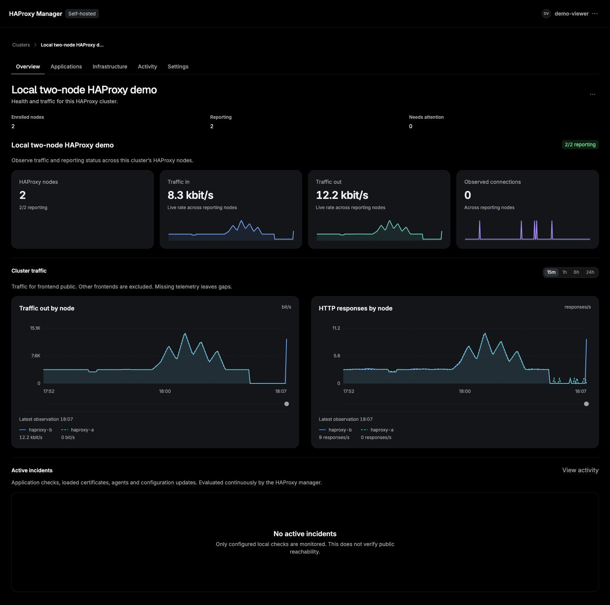

# Your first cluster and application

Fleet runs beside your existing HAProxy infrastructure. Install one manager and
an agent for each HAProxy node. Application servers do not need an agent.
Your shared entrypoint, HAProxy nodes and application servers carry traffic;
Fleet observes them and applies the changes you request.

Use the [signed installation guide](self-hosted-installation.md) for a server,
or the [two-node source demo](../README.md#try-it-from-source) to explore locally.
This walkthrough starts with a running manager and a local account. The
installation administrator creates accounts; there is no default password.



## Choose a cluster

Sign in at your installation's console URL. The home page lists clusters with
their reporting nodes, health and recent traffic. Open a cluster to work within
it. Use **Clusters** in the breadcrumb to return to the list.

| Section        | What you use it for                                                    |
| -------------- | ---------------------------------------------------------------------- |
| Overview       | Check reporting nodes, bandwidth, HTTP responses and active incidents. |
| Applications   | Manage hostname/path routes, backends, traffic rules and deployments.  |
| Infrastructure | Inspect nodes, topology, listeners, automatic TLS and rollouts.        |
| Activity       | Investigate incidents and recent operations.                           |
| Settings       | Configure the selected cluster's settings.                             |

The account menu contains **Installation settings**, theme selection and sign out.
Local administrators can manage the installation; viewers can inspect it.

## Enroll a HAProxy node

Create a cluster if you are starting with an empty installation, then open
**Infrastructure → Nodes → Enroll node**.

1. Name the node and select its cluster.
2. Choose the Linux or Docker install method. Set the metrics endpoint for that
   node's HAProxy process and the manager/ingestion addresses it can reach.
3. Copy the generated one-use command and run it on that node. The setup
   credential expires; generate another command if it is no longer valid.
4. Keep the setup drawer open until it confirms the node connected and is
   reporting metrics. The node should then show **Reporting** in the fleet.

Repeat for each HAProxy node, with its own metrics endpoint and persistent agent
identity directory. Monitoring needs metrics access. Configuration changes also
need Runtime API/Data Plane API access and explicit local management policy.
The [existing HAProxy guide](existing-haproxy.md) explains those permissions.

Provide the shared traffic entrypoint separately, such as a cloud load balancer
or your existing failover arrangement. Declaring a cluster groups its nodes for
management; traffic routing depends on your entrypoint and listener configuration.

## Create an application

Open **Applications → Create application**. Give it a name, HTTP hostname and
path prefix, then choose its listener. Add the backend servers that already run
your application, their weights, balancing strategy and health-check path.

With node management and entrypoint maintenance configured, deploy the change.
Fleet withdraws and drains one node at a time, applies the configuration, verifies
health and rejoins it before moving to the next node. Follow the result in
**Deployments**. A rollback creates a new version; use the version's actions there
to restore a retained configuration.

Before changing public DNS, send a request through your entrypoint with the
application hostname. For example, replace the documentation address below with
your own entrypoint IP:

```sh
curl --resolve shop.example.com:80:203.0.113.10 http://shop.example.com/
```

Test HTTPS with the real certificate hostname once HTTPS is configured:

```sh
curl --resolve shop.example.com:443:203.0.113.10 https://shop.example.com/
```

Use your CA trust bundle with `--cacert` for private certificates. See
[applications and TLS](applications.md) for shared listeners, DNS-01 issuance
and rollout verification.

## Inspect traffic

**Overview** shows node metrics and history. Open an application's **Traffic**
page to investigate its requests. Select a time range and filters, then open a
recorded path or request for details.

Request collection is configured per application. **Request search** needs
collected requests, and **Top paths** also needs an allowed path-capture policy
on the nodes. Node metrics can be healthy while these are empty. Check the
application's collection settings and the nodes' policy, then generate fresh
traffic and allow the requests to finish. See [observability](observability.md).

Country/ASN visibility uses the effective client IP and node-local Geo data.
Configure [trusted client IPs and Geo](geography.md) before relying on country
rules, especially behind another load balancer or proxy. Local/private client
addresses may have an unknown country.

## Operate and recover

Use a node's **Maintenance** page to withdraw and drain it, then explicitly
rejoin after health checks. Keep another healthy node serving during maintenance.
The [operations guide](operations.md) covers weights, backend edits and rollouts.

Back up the manager and each node's identity/TLS state before upgrades. Software
rollback and restoring data are different operations; follow the
[installation and recovery guide](self-hosted-installation.md).

## Add Converge when you need it

You can manage the same fleet through Converge using the
[outbound connector](converge-connector.md). Local login continues to work
independently. In Converge, HAProxy actions use permissions and agent policy;
DNS changes retain the zone's normal review, approval, apply and verification flow.
